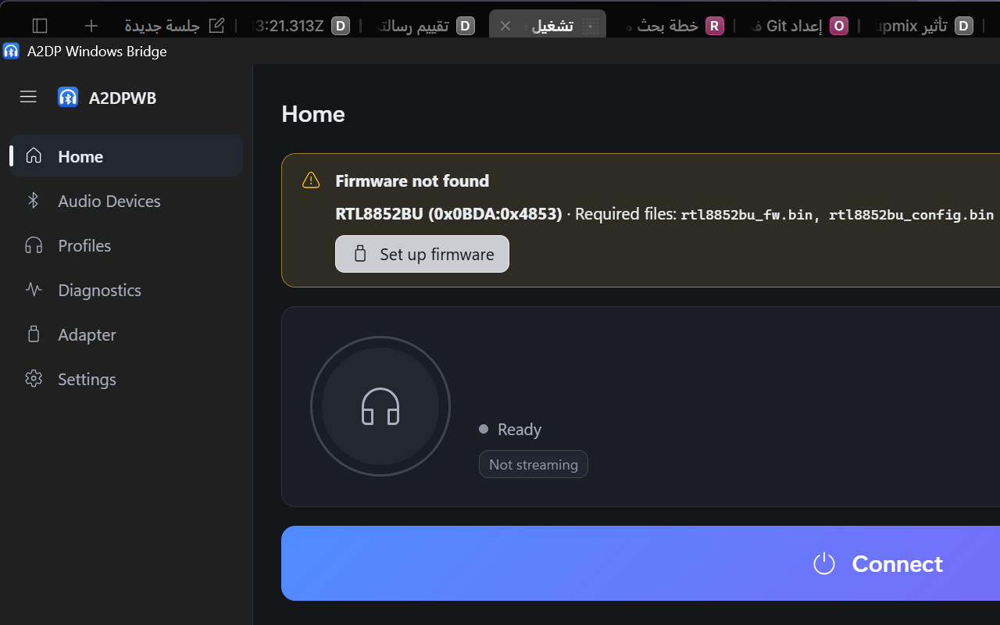
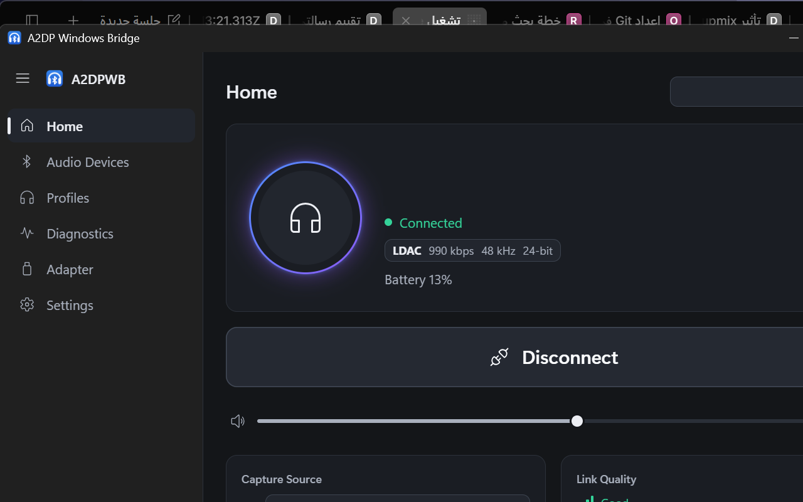

# 2.0.2-beta.4 on this PC — what the two open questions turned out to be

Answers to the two questions asked in
[upstream issue #81](https://github.com/SeiyaFunaokaJP/A2DP-Windows-Bridge/issues/81),
measured on the internal Realtek **RTL8852BU** (`USB\VID_0BDA&PID_4853`) with
**2.0.2-beta.4** installed.

## 1. Does the WinUSB assignment still need a manual replug? — **No**

Measured on this machine, with the stock `a2dpwb-driver.exe`:

```
a2dpwb-driver.exe assign <instance>
  -> "reboot_required": false        (2.0.1 said true)
  -> "kind": "winusb"
```

and then, **immediately, with no reboot and no unplug**, the very next scan:

```
INFO chip: RTL8852BU (0BDA:4853 -> 0xB85B) (auto)
INFO USB: opened 0BDA:4853 USB\VID_0BDA&PID_4853\00E04C0000XX (event 0x81, ACL 0x82/0x02)
INFO controller: company 0x005D (Realtek), HCI version 11, LMP subversion 0x8852
INFO Realtek firmware download ran (ROM LMP subversion 0x8852); not verified
INFO HCI ready (took 716 ms)
```

The device restart that the app now performs puts the module back into its ROM
code, and the app then uploads the firmware itself in the same run. The whole
`assign -> adapter works -> firmware uploaded` chain needed no manual step at
all. `error 50` never appeared once.

For the record, the same cycle on **2.0.1** needed a Windows restart (or a
manual replug) before the adapter could be claimed.

## 2. "Firmware not loaded" and Download Firmware on a cold module

Cold module = after a real Windows reboot, with all four firmware files
removed from the config folder.

### What the user sees

Home:



```
Firmware not found - RTL8852BU (0x0BDA:0x4853) - Required files: rtl8852bu_fw.bin, rtl8852bu_config.bin
[ Set up firmware ]
```

Adapter screen: the chip resolves (`Auto (RTL8852BU)`), the driver line reads
`WinUSB (used by A2DPWB)`, and the firmware block offers **Download** with a
confirmation dialog that states the source (linux-firmware / kernel.org), the
licence terms and that the files are not part of A2DPWB.

### What happens when the user accepts

The app fetched and installed the firmware, uploaded it, and streamed - with
no other action:

```
INFO a2dpwb_core::firmware: firmware download for RTL8852BU: saved ["rtl8852bu_fw.bin", "rtl8852bu_config.bin"] (linux-firmware 9a80a04)
INFO a2dpwb_core::state: firmware files are there now
INFO btstack: btstack_chipset_realtek.c.542: Opened file .../rtl8852bu_fw.bin and read 129733 bytes
INFO btstack: FW version 0xd6,25,35,01 | Patch length 0x1063d | eco 0x02
```



`Connected - LDAC 990 kbps - 48 kHz - 24-bit`, and the cold-boot run that
followed the same recovery streamed with **0 dropped packets**.

### One gap worth a look

On the cold module with the files missing, the log says:

```
INFO controller: ... LMP subversion 0x8852
INFO btstack_chipset_realtek.c.510: Failed to open file .../rtl8852bu_config
INFO btstack_chipset_realtek.c.953: Config size is 0, using efuse settings!
INFO Realtek firmware download ran (ROM LMP subversion 0x8852); not verified
```

**"download ran"** is printed although nothing could be downloaded (the files
are absent), and the ROM-code warning
(`Realtek firmware NOT loaded (LMP subversion 0x8852 is the ROM code)`) did not
appear - so the "Firmware not loaded" state never showed. What showed was the
older, file-based "Firmware not found".

Both states are worth having, and they are different:

| state | trigger | what the user should be told |
|---|---|---|
| Firmware not found | the files are not on disk | download them - the app can do it |
| Firmware not loaded | the controller runs its ROM code | the module is not patched, LDAC/LE Audio are not available |

Today the ROM case is only reached through the file case, so the ROM warning
is never printed. Suggesting: when the firmware files are missing **and** the
controller reports the ROM LMP subversion, report the ROM state as well, and
do not print "download ran" when no download was possible.

## 3. Two smaller observations

- **The extension-less copies are gone for good.** With the 4 files in the
  config folder (2 `.bin` + 2 extension-less copies) and beta.4, a single
  `--scan` left only the 2 `.bin` files - the app deleted the copies itself,
  twice in a row. The toolkit's `fetch-realtek-fw.ps1` now creates them only
  on request (`-LegacyAliases`).
- **The config file the app writes is empty.** The chip table has
  `config: None` for the RTL8852BU and the app writes a 0-byte
  `rtl8852bu_config.bin` (its own test does the same). BTstack then uses
  "efuse settings". A 6-byte `rtl8852bu_config.bin` with the hash the table
  already lists for `rtl8761bu_config.bin` was used here before, and both
  work: the module uploads and LDAC streams with 0 dropped packets either way.
  If the file exists in linux-firmware under the 8852BU name, listing it in the
  table would make the file on disk the real one.

## Reproduction

```powershell
# 1. the assign path (needs the UAC the helper asks for)
powershell -File scripts\usb-driver.ps1 -Mode restore -InstanceId 'USB\VID_0BDA&PID_4853\00E04C0000XX' -UseRecords
powershell -File scripts\usb-driver.ps1 -Mode assign  -InstanceId 'USB\VID_0BDA&PID_4853\00E04C0000XX'
# 2. the adapter must work right away, with no reboot
& "$env:LOCALAPPDATA\A2DP Windows Bridge\a2dpwb-core.exe" --cli --scan 6

# 3. the cold-module case: remove the firmware files, restart Windows, then
powershell -File scripts\cold-boot-test.ps1 -Mode Missing
```

The toolkit repo carries all of the scripts above plus the exact evidence:
<https://github.com/Akramx15/a2dpwb-nousb-toolkit>
