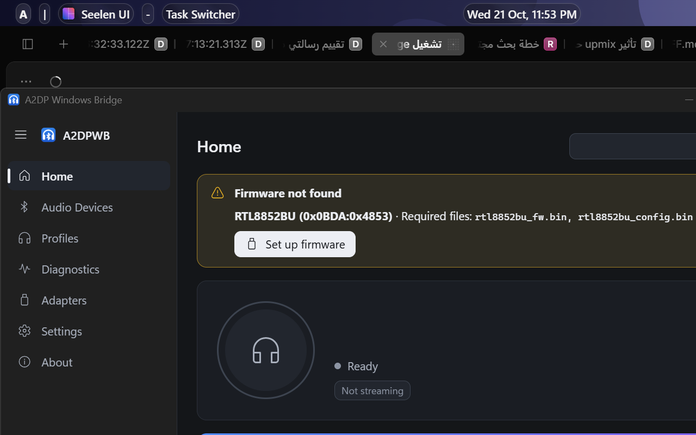
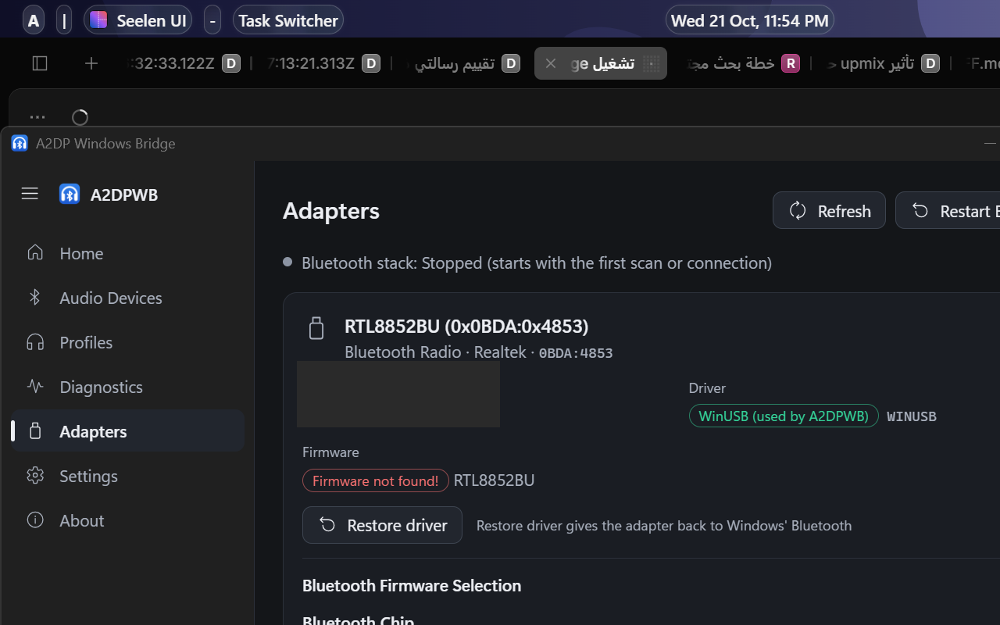
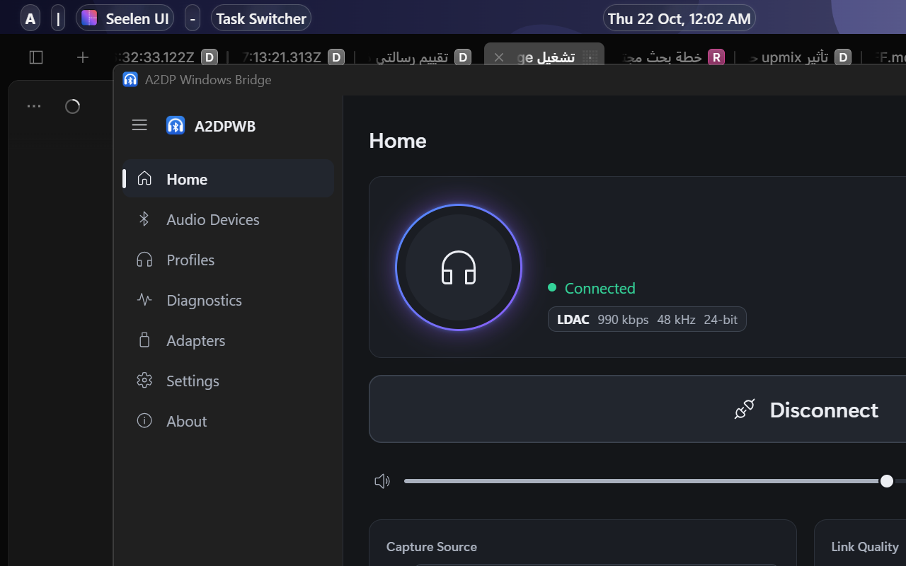

# 2.0.2-beta.5 on an RTL8852BU: the ROM state, the recovery, and the proof

The upstream author asked for an RTL8852BU test of 2.0.2-beta.5
([issue #81](https://github.com/SeiyaFunaokaJP/A2DP-Windows-Bridge/issues/81)):
*"None of this was tested on an RTL8852BU here."*

This is that test. Internal Realtek **RTL8852BU**
(`USB\VID_0BDA&PID_4853\00E04C0000XX`), the headset, Windows 11 build
26200.9711.

## 1. The ROM state is now reported - and it is correct

A real cold module (after a Windows restart) with the firmware files removed.
The controller runs its ROM code, so the LMP subversion is `0x8852`:

```
WARN firmware file missing: ...\A2DPWB\firmware\rtl8852bu_fw.bin
WARN firmware file missing: ...\A2DPWB\firmware\rtl8852bu_config.bin
INFO USB: opened 0BDA:4853 USB\VID_0BDA&PID_4853\00E04C0000XX (event 0x81, ACL 0x82/0x02)
INFO controller: company 0x005D (Realtek), HCI version 11, LMP subversion 0x8852
INFO btstack_chipset_realtek.c.510: Failed to open file .../rtl8852bu_fw
INFO btstack_chipset_realtek.c.510: Failed to open file .../rtl8852bu_config
INFO btstack_chipset_realtek.c.953: Config size is 0, using efuse settings!
INFO HCI ready (took 106 ms)
WARN Realtek firmware NOT loaded (LMP subversion 0x8852 is the ROM code; ...)
```

**This is the line that beta.4 never printed.** On beta.4 the same situation
printed `Realtek firmware download ran (ROM LMP subversion 0x8852); not
verified` - a download that never happened. On beta.5 the message is truthful,
and the PR #113 that implements it is credited to issue #81.

The UI shows the matching state:





(The adapter's own Bluetooth address is masked in the screenshot.)

## 2. The recovery is two clicks, and it works on a cold module

With the ROM state showing, `Set up firmware` downloads the files and the app
uploads them - no manual step, no file copy, no reboot:

```
INFO a2dpwb_core::firmware: firmware download for RTL8852BU: saved ["rtl8852bu_fw.bin", "rtl8852bu_config.bin"] (linux-firmware 9a80a04)
INFO btstack: btstack_chipset_realtek.c.542: Opened file .../firmware/rtl8852bu_fw.bin and read 129733 bytes
INFO btstack: FW version 0xd6,25,35,01,f8,c3,02,00
INFO controller: company 0x005D (Realtek), HCI version 11, LMP subversion 0xFD78
INFO bt_host::app: Realtek firmware loaded (LMP subversion 0x8852 -> 0xFD78)
INFO HCI ACL connection established
INFO a2dpwb_core::stream: codec selected: LDAC
INFO codec::ldac: LDAC: initialized (rate=48000, ch=2, 24-bit, quality=High, transport mtu=895, bitrate=990 kbps, abr=false)
INFO a2dpwb_core::service: state Streaming: Connected
```

`Realtek firmware loaded (LMP subversion 0x8852 -> 0xFD78)` is a new beta.5
line: the ROM-to-patched transition is now spelled out, which is exactly the
information that was missing in beta.4.



`Connected - LDAC 990 kbps - 48 kHz - 24-bit`, and the stream health line
reports `drops 0`, `errors 0`.

## 3. The firmware folder moved

```
INFO firmware file ...\A2DPWB\rtl8852bu_fw.bin moved to ...\A2DPWB\firmware\rtl8852bu_fw.bin
INFO bt_host::app: Realtek adapter PID 0xB85B, firmware folder ...\A2DPWB\firmware
```

The files are moved once, on the first run of the new build. The UI has
**Settings > Open Firmware Folder**; downloads are cached in
`%TEMP%\A2DPWB_cache`. The toolkit scripts detect the folder automatically
(`-FirmwareDir` overrides it).

## 4. The diagnostic bundle, scrubbed

`docs/evidence/a2dpwb-diag-2.0.2-beta.5-rtl8852bu-scrubbed.zip` is the bundle
from **Diagnostics > Report a problem > Save** of this beta.5 run, with the
user profile path removed and the raw Bluetooth addresses of both devices
zeroed in the HCI capture. Its `logs/a2dpwb-core.2026-10-21.log` contains the
whole day, so beta.4's misleading line and beta.5's correct ones sit next to
each other:

```
12:24:48 INFO bt_host::app: Realtek firmware download ran (ROM LMP subversion 0x8852); not verified   <- beta.4
00:02:07 INFO bt_host::app: Realtek firmware loaded (LMP subversion 0x8852 -> 0xFD78)                  <- beta.5
```

## 5. `rtl8852bu_config.bin` stays empty - confirmed

`linux-firmware` has no config file for the RTL8852BU, so the app writes a
0-byte `rtl8852bu_config.bin` and BTstack falls back to the efuse settings
(`Config size is 0, using efuse settings!`). The stream runs at the full
990 kbps with 0 drops, so there is nothing to fix here.

## Reproduction

```powershell
# the assign path (UAC)
powershell -File scripts\usb-driver.ps1 -Mode assign -Auto

# the cold-module case: remove the firmware files, restart Windows, then
powershell -File scripts\cold-boot-test.ps1 -Mode Missing
```

## The evidence in this repository

| file | what it shows |
|---|---|
| `images/beta5-home-firmware-not-found.png` | Home: "Firmware not found" + **Set up firmware** |
| `images/beta5-adapters-firmware-not-found.png` | Adapters: the firmware badge, the driver line |
| `images/beta5-streaming-after-in-app-download.png` | Connected, LDAC 990 kbps, after the in-app download |
| `evidence/a2dpwb-diag-2.0.2-beta.5-rtl8852bu-scrubbed.zip` | the scrubbed diagnostic bundle |

Repository: <https://github.com/Akramx15/a2dpwb-nousb-toolkit>
