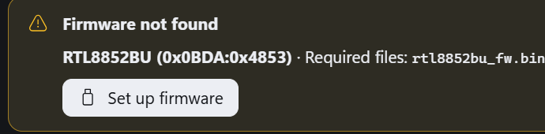

# Upstream test report: A2DP-Windows-Bridge 2.0.2-beta.1 on RTL8852BU

Result of the three-step procedure requested in
[upstream issue #81](https://github.com/SeiyaFunaokaJP/A2DP-Windows-Bridge/issues/81),
run on the reporter's machine with the internal Realtek **RTL8852BU**
(`USB\VID_0BDA&PID_4853`).

**Verdict: the fix works. LDAC 990 kbps streams over the internal adapter with
0 dropped packets.** The beta can go to 2.0.2 as far as this hardware goes.

## Environment

| | |
|---|---|
| OS | Windows 11 build 26200.9711 (25H2), x64 |
| Build under test | `A2DPWB-2.0.2-beta.1-win64-portable.zip` (portable, same binaries as the installer) |
| Adapter | internal USB `0BDA:4853` = Realtek RTL8852BU, WinUSB-bound |
| Headset | the headset, classic A2DP, LE Audio off, address `<HEADSET_MAC>` |
| Firmware | `rtl8852bu_fw.bin` (129,733 B) + `rtl8852bu_config.bin` (6 B) |

## Step 1 — firmware files removed

All four files (`rtl8852bu_fw`, `rtl8852bu_config` and both `.bin` files) were
moved out of `%APPDATA%\A2DPWB`. The beta then reports the chip and the missing
files by name, which is exactly what 2.0.1 could not do:

```
INFO chip: RTL8852BU (0xB85B) (auto)
WARN firmware file missing: %APPDATA%\A2DPWB\rtl8852bu_fw.bin
WARN firmware file missing: %APPDATA%\A2DPWB\rtl8852bu_config.bin
```

The GUI shows the same state, with the chip named by its **actual USB PID** and
a way to fix it:



> `Firmware not found — RTL8852BU (0x0BDA:0x4853) · Required files: rtl8852bu_fw.bin`
> with a **Set up firmware** button.

### One observation worth documenting

With the files removed, **the adapter still opened** on a warm module:

```
INFO USB: opened 0BDA:4853 USB\VID_0BDA&PID_4853\00E04C0000XX (event 0x81, ACL 0x82/0x02)
INFO Realtek: Firmware already exists
INFO Realtek firmware already running from an earlier session (LMP subversion 0xFD78), download skipped
INFO HCI ready (took 98 ms)
```

The Realtek module keeps the uploaded firmware in RAM, so a **warm** module
boots even with no firmware on disk.

`failed to initialize WinUSB (error 50)` is **not** a firmware symptom, and
"only reproduces on a cold module" was the wrong reading of the correlation. It
means the WinUSB binding is not live yet: the helper's driver record says
`"reboot_required": true` at assign time and the adapter opens once the device
is re-enumerated (upstream's remedy: unplug/replug). The missing firmware is a
separate, nameable condition that leaves the module in ROM mode.

Two consequences:

- the new warning is the reliable signal — the adapter may still open while the
  firmware files are missing, so the warning must not be read as "it works";
- a troubleshooting note like *"the adapter opening is not proof that the
  firmware was loaded; check for `firmware file missing`"* would save a lot of
  confusion.

### Round 2: cold module, no firmware on disk

After a real Windows reboot, with all four files removed from `%APPDATA%\A2DPWB`
beforehand (build 2.0.2-beta.1):

| Phase | `%APPDATA%\A2DPWB` | Result |
|---|---|---|
| 1 | nothing | the adapter **opened** and HCI came up, with both `firmware file missing` warnings |
| 2 | only the `.bin` files | the app recreated the extension-less aliases, uploaded the firmware and re-opened the adapter |
| 3 | patched module | LDAC, 3,783 packets, 0 dropped |

Phase 1 — the ROM code alone is enough to open the adapter and serve HCI:

```
INFO USB: opened 0BDA:4853 ... (event 0x81, ACL 0x82/0x02)
INFO HCI ready (took 102 ms)
WARN firmware file missing: %APPDATA%\A2DPWB\rtl8852bu_fw.bin
WARN firmware file missing: %APPDATA%\A2DPWB\rtl8852bu_config.bin
```

Phase 2 — the firmware path still works when the `.bin` files come back:

```
ROM LMP subversion: 0x8852; download ran: True
alias rtl8852bu_fw: True; alias rtl8852bu_config: True
```

Phase 3 — `state Streaming: Connected`, 3,783 media packets, 0 dropped.

So a cold, unpatched module opens and serves HCI from ROM. What the firmware
buys is a **patched** module, not an openable one; the `firmware file missing`
warning is how that case is detected by name.

## Step 2 — the Adapter screen

Expected: `RTL8852BU (0x0BDA:0x4853)` with the firmware files marked as not
found. **Observed exactly that** (screenshot above).

Small note for the logs, not a bug: the **UI** shows the real USB PID
(`0x0BDA:0x4853`) while the **CLI** log line prints the resolved family PID
(`chip: RTL8852BU (0xB85B)`), because the family PID is what BTstack is given.
Printing both would be friendlier, e.g. `chip: RTL8852BU (0x0BDA:0x4853 ->
family PID 0xB85B)`.

## Step 3 — the `.bin` files put back, then connect

Only the two `.bin` files were restored; the extension-less copies were
deleted. The beta **created them itself** before opening the adapter:

```
rtl8852bu_config.bin   6        rtl8852bu_config       6      <- created by the app
rtl8852bu_fw.bin  129733        rtl8852bu_fw      129733      <- created by the app
```

Then the connection and the stream:

```
INFO remote supports SBC (SEID 1, frequencies 0x3, channel modes 0xF, blocks 0xF, subbands 0x3, allocation 0x3, bitpool 2-53) - SBC XQ possible
INFO remote supports AAC (SEID 2)
INFO remote supports LDAC (SEID 3, [2D, 01, 00, 00, AA, 00, 3C, 07])
INFO codec selected: LDAC
INFO codec configured (local 1, remote 3)
INFO LDAC: initialized (rate=48000, ch=2, 24-bit, quality=High, transport mtu=895, bitrate=990 kbps, abr=false)
INFO encoder ready: LDAC 990 kbps, mtu 883, 24-bit, ABR false
INFO state Streaming: Connected
Sent 3772 media packets (2538556 bytes), 0 dropped before the radio
```

No `firmware file missing` warning, no `error 50`, **0 dropped packets**.

## Summary

| Step | Expected | Result |
|---|---|---|
| 1. firmware removed | the app names the chip and the missing files | yes (WARN + GUI banner) |
| 2. Adapter screen | `RTL8852BU (0x0BDA:0x4853)`, files not found | yes, exactly |
| 3. `.bin` back, connect | aliases made by the app, stream works | yes, LDAC 990 kbps, 0 dropped |

The chip-table fix, the missing-firmware log hint and the setup-guide changes
all behave as intended on real RTL8852BU hardware.
